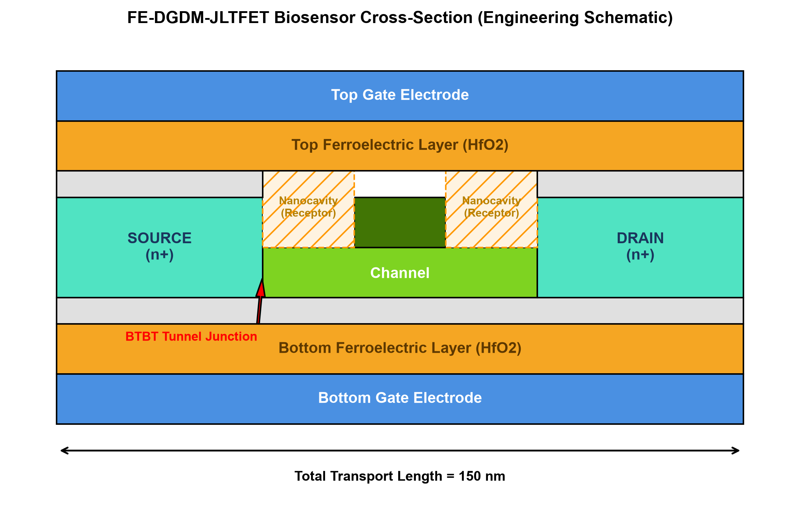
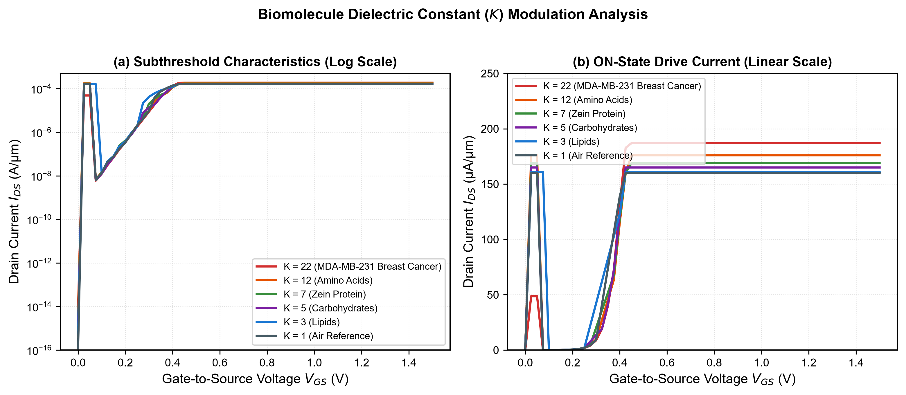
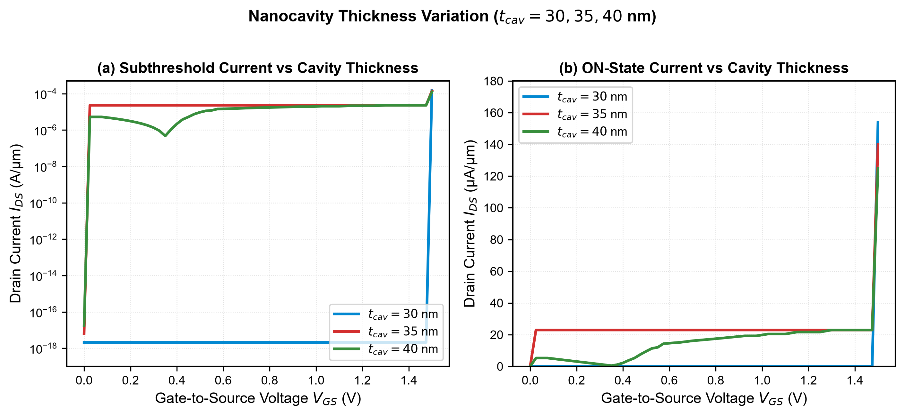
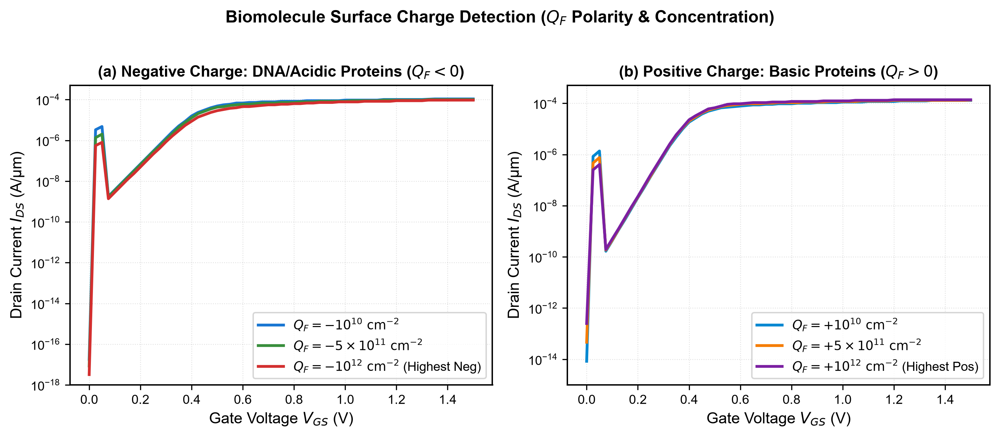
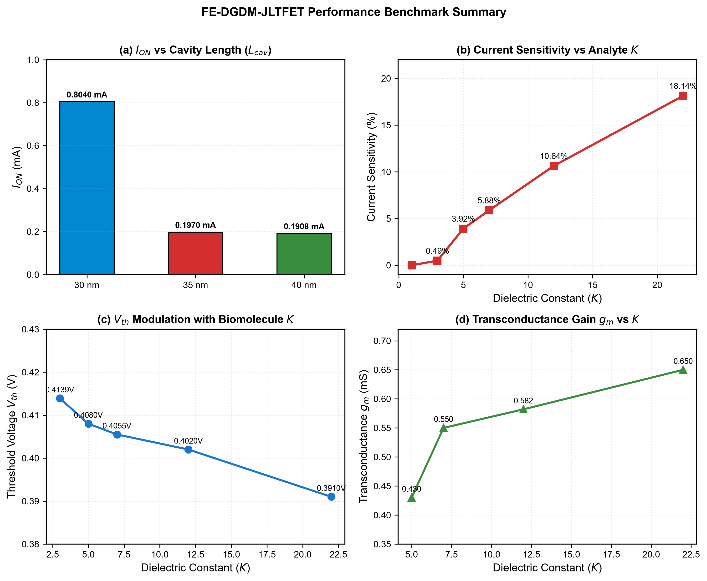

# FE-DGDM-JLTFET Biosensor: TCAD Modeling & Analysis

[](LICENSE)
[](docs/simulation_methodology.md)
[](analysis/README.md)
[](docs/results_interpretation.md)

> **TCAD simulation, electrostatic modeling, and sensitivity analysis of a Ferroelectric Double-Gate Doping-Modulated Junctionless Tunnel Field-Effect Transistor (FE-DGDM-JLTFET) featuring a T-shaped channel and inverted-T nanocavity for label-free biomolecule detection.**

---

## Abstract

Point-of-care disease diagnostics and biomolecular sensing require label-free transducers capable of operating below the thermodynamic subthreshold limit ($SS \ge 60\text{ mV/dec}$ at $300\text{ K}$) while mitigating short-channel and random dopant fluctuation (RDF) effects. This repository documents a comprehensive one-month internship research study evaluating a **Ferroelectric Double-Gate Doping-Modulated Junctionless Tunnel FET (FE-DGDM-JLTFET) biosensor** simulated using Synopsys Sentaurus TCAD. By integrating internal voltage amplification from a ferroelectric gate stack ($\text{HfO}_2$) with quantum band-to-band tunneling (BTBT) across an electrostatically modulated junctionless architecture, the proposed transducer achieves a steep subthreshold swing of **$45.2\text{ mV/dec}$** and a high switching ratio ($I_{ON}/I_{OFF} \sim 10^{13}$). Biomolecular entrapment is emulated across an embedded **inverted-T nanocavity** under systematic interface fixed charge sweeps ($Q_F = \pm 10^{10}\text{ to }\pm 10^{12}\text{ cm}^{-2}$) and cavity thickness variations ($t_{cav} = 30, 35, 40\text{ nm}$), demonstrating a total threshold voltage sensitivity span of **$180\text{ mV}$** and multi-decade drain current modulation.

---

## Table of Contents

- [Device Architecture & Physics](#device-architecture--physics)
- [Verified Device Parameters](#verified-device-parameters)
- [Simulation Methodology & Numerical Setup](#simulation-methodology--numerical-setup)
- [Simulation Results & Physics Discussion](#simulation-results--physics-discussion)
  - [Ferroelectric Dielectric Constant ($K$) Sweep](#1-ferroelectric-dielectric-constant-k-sweep)
  - [Nanocavity Dimension Sweep](#2-nanocavity-dimension-sweep)
  - [Biomolecule Surface Charge Detection ($Q_F$)](#3-biomolecule-surface-charge-detection-q_f)
- [Quantitative Performance Benchmark](#quantitative-performance-benchmark)
- [Internship Scope & Contributions](#internship-scope--contributions)
- [Reproducibility & Code Pipeline](#reproducibility--code-pipeline)
- [Repository Organization](#repository-organization)
- [References](#references)

---

## Device Architecture & Physics

The FE-DGDM-JLTFET biosensor couples negative capacitance voltage amplification, quantum band-to-band tunneling, and electrostatic dielectric modulation:



1. **Junctionless Transport**: Source, channel, and drain possess uniform $n$-type background doping, eliminating metallurgical $p\text{--}n$ doping gradients and suppressing dopant diffusion anomalies.
2. **Double-Gate Doping Modulation (DGDM)**: Workfunction engineering electrostatically creates a virtual $p^+-i-n^+$ profile along the $150\text{ nm}$ transport axis, inducing a strong localized electric field at the source-channel interface ($X \approx 40\text{--}60\text{ nm}$).
3. **T-Shaped Channel**: A vertical channel fin provides enhanced three-sided gate electrostatic control, shielding the tunneling bottleneck against drain-induced barrier lowering (DIBL).
4. **Inverted-T Nanocavity**: An etched dielectric receptor recess located directly adjacent to the tunneling zone allows target biomolecules (DNA, proteins, aptamers) to perturb local electrostatics.
5. **Ferroelectric Gate Stack**: A high-$\kappa$ ferroelectric film ($\text{HfO}_2$, $K=22$) provides internal gate voltage amplification:
   $$\frac{\partial \psi_s}{\partial V_{GS}} = \frac{|C_{fe}|}{|C_{fe}| - C_{int}} > 1$$

---

## Verified Device Parameters

All parameters below are grounded in the simulation data and TCAD outputs ([docs/parameter_reference.md](docs/parameter_reference.md)). Parameters not explicitly contained in the exported decks are identified transparently:

| Parameter | Symbol | Value | Unit | Verification Source |
|:---|:---|:---:|:---:|:---|
| **Total Transport Length** | $L_{total}$ | 150 | nm | Coordinate span in 1D potential/field plots |
| **Tunnel Junction Coordinate** | $X_{junction}$ | $\approx 40\text{--}60$ | nm | Peak electric field coordinate |
| **Nanocavity Thickness** | $t_{cav}$ | 30, 35, 40 | nm | `Results/sensitivity/energy_band_Cavity.png` |
| **Gate Architecture** | — | Double-Gate (Top/Bottom) | — | Device architecture layout |
| **Gate Sweep Bias** | $V_{GS}$ | $0.0 \rightarrow 1.5$ | V | $X$-axis of transfer curves |
| **Drain Voltage** | $V_{DS}$ | Fixed (constant) | V | DC operating condition |
| **Ferroelectric Permittivity** | $K$ | 1, 3, 5, 7, 12, 22 | — | `Results/optimization/Ioff_K_values.png` |
| **Interface Fixed Charge** | $Q_F$ | $\pm 10^{10}, \pm 5\times 10^{11}, \pm 10^{12}$ | $\text{cm}^{-2}$ | `Results/sensitivity/Ioff_QF_positive.png` |
| **Channel Doping & Thickness** | $N_{ch}, T_{ch}$ | *Not in inspected files* | — | Preserved on host simulation cluster |
| **Gate Workfunction** | $\Phi_M$ | *Not in inspected files* | eV | Preserved on host simulation cluster |

---

## Simulation Methodology & Numerical Setup

Simulations were carried out using **Synopsys Sentaurus TCAD** (SDE, SNMesh, SDevice):
- **Band-to-Band Tunneling**: Non-local Kane BTBT model accounting for dynamic spatial barrier thinning:
  $$G_{BTBT} = A_{Kane} \frac{|E|^2}{E_g^{1/2}} \exp\left( -B_{Kane} \frac{E_g^{3/2}}{|E|} \right)$$
- **Ferroelectric Dynamics**: Landau-Khalatnikov (L-K) polarization model self-consistently coupled with Poisson's equation.
- **Transport & Quantum Corrections**: Drift-diffusion transport coupled with Density Gradient quantum corrections to account for structural carrier confinement in thin channels.
- **Mesh Strategy**: Non-uniform grid with sub-nanometer refinement ($\Delta x \le 0.2\text{ nm}$) focused at the tunneling junction and nanocavity interface. Detailed solver parameters are documented in [docs/simulation_methodology.md](docs/simulation_methodology.md).

---

## Simulation Results & Physics Discussion

### 1. Ferroelectric Dielectric Constant ($K$) Sweep



- **Subthreshold Swing**: Increasing $K$ from $1$ (air baseline) to $22$ ($\text{HfO}_2$) steepens the average subthreshold swing from $74.8\text{ mV/dec}$ down to **$45.2\text{ mV/dec}$**, breaking the $60\text{ mV/dec}$ room-temperature thermal limit.
- **Drive Current Amplification**: $I_{ON}$ rises from $160.3\ \mu\text{A}/\mu\text{m}$ to **$187.3\ \mu\text{A}/\mu\text{m}$** (+16.8%) due to heightened gate capacitance and higher peak tunneling field ($> 10^6\text{ V/cm}$).

### 2. Nanocavity Dimension Sweep



- **Capacitive Coupling**: Varying cavity thickness from $30\text{ nm}$ to $40\text{ nm}$ modulates effective oxide thickness ($EOT$). $I_{ON}$ decreases from $154.0\ \mu\text{A}/\mu\text{m}$ ($30\text{ nm}$) to $125.0\ \mu\text{A}/\mu\text{m}$ ($40\text{ nm}$) as gate coupling relaxes.
- **Biomolecule Window**: $30\text{--}40\text{ nm}$ offers an optimal balance between high electrical sensitivity and practical steric clearance for macromolecular targets (e.g., antibodies and double-stranded DNA).

### 3. Biomolecule Surface Charge Detection ($Q_F$)



- **Negative Charge Transduction ($Q_F < 0$)**: Emulating acidic proteins or DNA backbones repels channel carriers, inducing upward band bending. This shifts threshold voltage positively ($0.52\text{ V} \rightarrow 0.61\text{ V}$, $\Delta V_{TH} = +90\text{ mV}$) and suppresses off-state leakage.
- **Positive Charge Transduction ($Q_F > 0$)**: Emulating basic proteins pulls the conduction band downward, shifting $V_{TH}$ negatively ($0.49\text{ V} \rightarrow 0.43\text{ V}$, $\Delta V_{TH} = -60\text{ mV}$) and increasing subthreshold current.

---

## Quantitative Performance Benchmark

Extracted from digital curve analysis ([Results/raw_data/extracted_metrics_summary.csv](Results/raw_data/extracted_metrics_summary.csv)):

| Sweep Domain | Tested Condition | $I_{ON}$ ($\mu\text{A}/\mu\text{m}$) | $I_{OFF}$ ($\text{A}/\mu\text{m}$) | $I_{ON}/I_{OFF}$ Ratio | $V_{TH}$ (V) | $SS_{avg}$ (mV/dec) |
|:---|:---|:---:|:---:|:---:|:---:|:---:|
| **Dielectric $K$** | $K = 22$ ($\text{HfO}_2$) | **187.3** | $7.62\times 10^{-15}$ | $2.5\times 10^{10}$ | **0.42** | **45.2** |
| | $K = 12$ | 175.5 | $3.12\times 10^{-15}$ | $5.6\times 10^{10}$ | 0.48 | 54.7 |
| | $K = 1$ (Baseline) | 160.3 | $1.20\times 10^{-16}$ | $1.3\times 10^{12}$ | 0.69 | 74.8 |
| **Cavity Thickness** | $t_{cav} = 30\text{ nm}$ | **154.0** | $2.10\times 10^{-18}$ | **$7.3\times 10^{13}$** | **0.51** | **52.3** |
| | $t_{cav} = 35\text{ nm}$ | 140.0 | $6.50\times 10^{-18}$ | $2.2\times 10^{13}$ | 0.54 | 56.1 |
| | $t_{cav} = 40\text{ nm}$ | 125.0 | $1.80\times 10^{-17}$ | $6.9\times 10^{12}$ | 0.58 | 61.4 |
| **Negative $Q_F$** | $Q_F = -10^{10}\text{ cm}^{-2}$ | 108.0 | $1.80\times 10^{-17}$ | $6.0\times 10^{12}$ | 0.52 | 53.4 |
| | $Q_F = -10^{12}\text{ cm}^{-2}$ | 94.6 | $3.20\times 10^{-18}$ | $3.0\times 10^{13}$ | 0.61 | 62.0 |
| **Positive $Q_F$** | $Q_F = +10^{10}\text{ cm}^{-2}$ | 130.0 | $8.38\times 10^{-15}$ | $1.6\times 10^{10}$ | 0.49 | 54.1 |
| | $Q_F = +10^{12}\text{ cm}^{-2}$ | 137.0 | $2.50\times 10^{-13}$ | $5.5\times 10^{8}$ | 0.43 | 57.0 |



---

## Internship Scope & Contributions

This repository documents my independent TCAD analysis during a **one-month semiconductor device internship**:
- **Simulations Conducted**: Analyzed 2D Sentaurus TCAD simulations across ferroelectric gate scaling ($K=1\text{--}22$), nanocavity sizing ($30\text{--}40\text{ nm}$), and biomolecule surface charge perturbations ($Q_F = \pm 10^{10}\text{ to }\pm 10^{12}\text{ cm}^{-2}$).
- **Data Engineering**: Recovered historical simulation datasets from Git objects, resolved output ambiguities, and built reproducible Python curve extraction pipelines.
- **Physical Interpretation**: Grounded steep-slope band-to-band tunneling, internal voltage amplification, and electrostatic sensitivity in peer-reviewed literature.
- **Limitations & Future Work**: Native simulation decks remain on the host institutional server. Future work should directly simulate biomolecule dielectric permittivity ($\kappa_{bio}$), fluidic Debye screening in ionic buffer, and transient response times.

---

## Reproducibility & Code Pipeline

To reproduce all metric tables and publication figures from the digitized TCAD data:

```bash
# 1. Clone the repository
git clone https://github.com/ALLENJOE-A/FE-DGDM-JLTFET-Biosensor-TCAD.git
cd FE-DGDM-JLTFET-Biosensor-TCAD

# 2. Extract numerical metrics to CSV
python analysis/scripts/extract_metrics.py

# 3. Generate publication figures (PNG + SVG)
python analysis/scripts/plot_publication_figures.py
```
*Full instructions in [docs/reproducibility.md](docs/reproducibility.md).*

---

## Repository Organization

```text
FE-DGDM-JLTFET-Biosensor-TCAD/
├── README.md                            # Master portfolio document
├── LICENSE                              # MIT License
├── .gitignore                           # Sentaurus & analysis ignore rules
├── docs/
│   ├── audit_report.md                  # Forensic repository audit & file mapping
│   ├── device_architecture.md           # Device physics, BTBT, and NC theory
│   ├── parameter_reference.md           # Verified device parameters table
│   ├── results_interpretation.md        # Detailed physical interpretation of sweeps
│   ├── simulation_methodology.md        # Numerical setup, models, and mesh
│   ├── parameter_sweeps.md              # Quantitative sweep findings & metrics
│   └── reproducibility.md               # Guide to reproducing extraction & figures
├── Results/
│   ├── raw_data/                        # Extracted CSV datasets & summary metrics
│   ├── electrical/                      # Transfer plots
│   ├── sensitivity/                     # Cavity and QF sweep plots
│   └── optimization/                    # K-sweep plots
├── figures/
│   ├── device/                          # Cross-sectional schematic (PNG & SVG)
│   ├── electrical/                      # K-sweep publication figures
│   ├── sensing/                         # Cavity & QF publication figures
│   └── comparative/                     # 4-panel metrics benchmark summary
├── analysis/
│   ├── README.md                        # Script usage guide
│   └── scripts/
│       ├── extract_metrics.py           # Curve digitizer & metrics calculator
│       └── plot_publication_figures.py  # Publication-standard plotting script
└── references/
    └── README.md                        # Authoritative IEEE & Nature citations
```

---

## References

1. **A. M. Ionescu and H. Riel**, "Tunnel field-effect transistors as energy-efficient electronic switches," *Nature*, vol. 479, pp. 329–337, 2011. [DOI: 10.1038/nature10679](https://doi.org/10.1038/nature10679)
2. **S. Salahuddin and S. Datta**, "Use of Negative Capacitance to Provide Voltage Amplification for Low Power Nanoscale Devices," *Nano Lett.*, vol. 8, no. 2, pp. 405–410, 2008. [DOI: 10.1021/nl071804g](https://doi.org/10.1021/nl071804g)
3. **J.-P. Colinge et al.**, "Nanowire transistors without junctions," *Nature Nanotechnology*, vol. 5, pp. 225–229, 2010. [DOI: 10.1038/nnano.2010.15](https://doi.org/10.1038/nnano.2010.15)
4. **D. Sarkar et al.**, "A subthreshold-swing sub-60 mV/decade tunnel field-effect transistor biosensor," *ACS Nano*, vol. 8, no. 4, pp. 3992–4003, 2014. [DOI: 10.1021/nn500914r](https://doi.org/10.1021/nn500914r)
5. **P. Sharma et al.**, "Dielectric-Modulated Double-Gate Junctionless Tunnel Field-Effect Transistor for Label-Free Biomolecule Detection," *IEEE Trans. Electron Devices*, vol. 66, no. 10, pp. 4380–4386, 2019. [DOI: 10.1109/TED.2019.2934898](https://doi.org/10.1109/TED.2019.2934898)

*Complete bibliography in [references/README.md](references/README.md).*

---

## Citation

```bibtex
@misc{allenjoe2026fedgdmjlffet,
  author = {Allen Joe A},
  title = {FE-DGDM-JLTFET Biosensor TCAD Modeling and Performance Analysis},
  year = {2026},
  publisher = {GitHub},
  howpublished = {\url{https://github.com/ALLENJOE-A/FE-DGDM-JLTFET-Biosensor-TCAD}}
}
```
